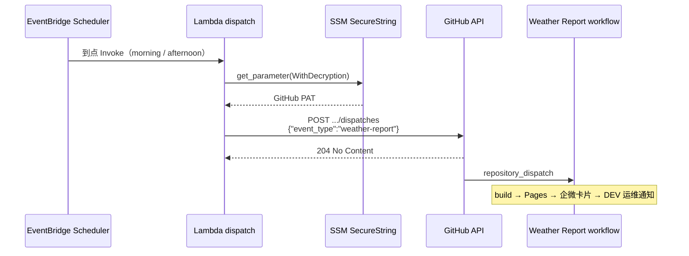

# AWS → GitHub Actions 触发机制与配置

> 本文说明本项目如何用 AWS 定时触发 GitHub Actions（GHA）Weather Report，以及两端配置项。  
> 部署命令见 [`../infra/eventbridge-weather/README.md`](../infra/eventbridge-weather/README.md)；迁移决策见 [`eventbridge-wecom-migration-lessons.md`](./eventbridge-wecom-migration-lessons.md)。

## 1. 做了什么

GitHub Actions **没有**用 `schedule` 做唯一定时源。定时放在 AWS：

```
EventBridge Scheduler（北京 06:05 / 17:05）
  → Lambda（读 SSM 中的 GitHub PAT）
  → GitHub API：POST /repos/{owner}/{repo}/dispatches
  → repository_dispatch（event_type = weather-report）
  → GHA workflow「Weather Report」
```

| 侧 | 职责 |
|----|------|
| AWS | 只负责「到点叫醒」：调度、鉴权调 GitHub、可观测日志 |
| GHA | 拉天气、渲染、部署 Cloudflare Pages、发企微卡片与运维通知 |

手动补发可用仓库里的 `workflow_dispatch`，不经过 AWS。

## 2. 为什么这样接

| 点 | 说明 |
|----|------|
| 触发方式 | `repository_dispatch`，由外部 HTTP 带 PAT 调用 GitHub API |
| 不用 GHA `cron` | 历史漏发后改为 AWS 单一定时源，避免双通道双发 |
| 中间加 Lambda | 可打 CloudWatch 日志、可 `lambda invoke` 验证；比 Scheduler 直调 GitHub 更好排障 |
| PAT 存 SSM | SecureString Standard，模板只引用参数名，不把密钥写进 CloudFormation |

## 3. 端到端数据流



成功时 GitHub 对 dispatch 返回 **204**（无 body）；Lambda 把 `status` 打到日志并返回 `{"ok": true, "status": 204}`。

## 4. AWS 侧配置

IaC：[`infra/eventbridge-weather/template.yaml`](../infra/eventbridge-weather/template.yaml)  
栈名（当前）：`pazhou-weather-dispatcher`  
区域（当前）：`us-west-2`

### 4.1 EventBridge Scheduler

| Schedule | Expression | Timezone | 含义 |
|----------|------------|----------|------|
| `{stack}-morning` | `cron(5 6 * * ? *)` | `Asia/Shanghai` | 北京 06:05 |
| `{stack}-afternoon` | `cron(5 17 * * ? *)` | `Asia/Shanghai` | 北京 17:05 |

- `FlexibleTimeWindow: OFF`：不抖动延迟  
- Target：同一 Lambda ARN  
- Retry：最多 2 次，事件最大保留 1 小时  

Scheduler 使用独立 IAM Role，仅允许 `lambda:InvokeFunction` 该函数。

### 4.2 Lambda

| 项 | 值 |
|----|-----|
| 函数名 | `{stack}-dispatch`（现网约 `pazhou-weather-dispatcher-dispatch`） |
| Runtime | Python 3.12 |
| 逻辑 | 内联在模板 `ZipFile`（`index.handler`） |

环境变量（由 CloudFormation Parameters 注入）：

| 变量 | 默认 / 现网 | 含义 |
|------|-------------|------|
| `GH_OWNER` | `Yun-Hai-Org` | 仓库 owner |
| `GH_REPO` | `pazhou-weather` | 仓库名 |
| `EVENT_TYPE` | `weather-report` | 必须与 workflow `types` 一致 |
| `PARAM_NAME` | `/pazhou-weather-dispatcher/github-pat` | SSM 参数名 |

核心行为：

1. `ssm.get_parameter(Name=PARAM_NAME, WithDecryption=True)` 取 PAT  
2. `POST https://api.github.com/repos/{owner}/{repo}/dispatches`  
3. Header：`Authorization: Bearer <PAT>`、`Accept: application/vnd.github+json`  
4. Body：`{"event_type": "<EVENT_TYPE>"}`  
5. 非 2xx → 抛错（Scheduler 可按策略重试）

Lambda Role：基础执行日志 + `AmazonSSMReadOnlyAccess`。

### 4.3 GitHub PAT（SSM）

| 项 | 说明 |
|----|------|
| 参数名 | `/pazhou-weather-dispatcher/github-pat` |
| 类型 | SecureString（Standard） |
| 写入方式 | CLI `aws ssm put-parameter`（账号下 CFN 不能直接创建 SecureString） |
| PAT 权限 | Fine-grained；目标仓库 **Contents: Read and write**（足以触发 `repository_dispatch`） |

轮换：更新 SSM 参数值即可，一般无需改栈。

### 4.4 CloudFormation Parameters

部署时可覆盖：

```text
GitHubOwner / GitHubRepo / EventType / PatParameterName
```

## 5. GitHub Actions 侧配置

文件：[`.github/workflows/weather.yml`](../.github/workflows/weather.yml)

```yaml
on:
  repository_dispatch:
    types: [weather-report]   # 必须与 Lambda EVENT_TYPE 一致
  workflow_dispatch:          # 人工手动跑，不经 AWS
```

与「外部调度」相关的行为：

| 条件 | 行为 |
|------|------|
| `github.event_name == 'repository_dispatch'` | 设置 `WECOM_SKIP_PROD_WEEKENDS=1`（周末天气卡片改走 DEV，不发 PROD） |
| `workflow_dispatch` | 上述开关为 `0`（按当天规则正常走生产配置） |
| 运维 notify | `notify-wecom` 将 `repository_dispatch` 显示为「外部调度」 |

GHA 侧 Secrets / Variables（天气与部署用，**不是** AWS 触发凭证）见根目录 README；触发链路本身只依赖 AWS 上的 PAT。

## 6. 配置对照清单

| 配置点 | 位置 | 必须一致 / 正确 |
|--------|------|-----------------|
| `event_type` | Lambda `EVENT_TYPE` | = workflow `types: [weather-report]` |
| owner/repo | Lambda 环境变量 | = 实际仓库 `Yun-Hai-Org/pazhou-weather` |
| PAT | SSM SecureString | 有效、未过期、有 Contents 写权限 |
| 时区 | Scheduler `Asia/Shanghai` | cron 按北京本地墙钟解释 |
| Region | 现网 `us-west-2` | 与栈、日志、Invoke 一致 |

## 7. 部署与验证（摘要）

```bash
export AWS_REGION=us-west-2
PARAM=/pazhou-weather-dispatcher/github-pat

# PAT 写入 SSM（新建或覆盖）
aws ssm put-parameter \
  --name "$PARAM" \
  --type SecureString \
  --value 'YOUR_GITHUB_PAT' \
  --overwrite

# 部署栈
cd infra/eventbridge-weather
aws cloudformation deploy \
  --region us-west-2 \
  --stack-name pazhou-weather-dispatcher \
  --template-file template.yaml \
  --capabilities CAPABILITY_NAMED_IAM \
  --parameter-overrides \
    GitHubOwner=Yun-Hai-Org \
    GitHubRepo=pazhou-weather \
    PatParameterName="$PARAM"

# 手动 Invoke 验证
FN=$(aws cloudformation describe-stacks \
  --region us-west-2 \
  --stack-name pazhou-weather-dispatcher \
  --query "Stacks[0].Outputs[?OutputKey=='DispatchFunctionName'].OutputValue" \
  --output text)
aws lambda invoke --region us-west-2 --function-name "$FN" /tmp/weather-dispatch-out.json
cat /tmp/weather-dispatch-out.json   # 期望含 "status": 204
```

成功后：Actions 出现由 `repository_dispatch` 触发的「Weather Report」run。

## 8. 排障

| 现象 | 先查 |
|------|------|
| 到点无 GHA run | Scheduler 状态是否 ENABLED；Lambda 是否有新日志 |
| Lambda 报 401/403 | SSM 中 PAT 是否过期/权限不足 |
| 204 但仍无 workflow | `event_type` 是否与 `types` 一致；workflow 是否在默认分支 |
| 有 run 但企微异常 | 属 GHA/Secret 问题，不是 AWS 调度问题 |

日志：

- CloudWatch：`/aws/lambda/pazhou-weather-dispatcher-dispatch`
- Scheduler 名：`pazhou-weather-dispatcher-morning` / `pazhou-weather-dispatcher-afternoon`

## 9. 相关文件

| 文件 | 作用 |
|------|------|
| `infra/eventbridge-weather/template.yaml` | Scheduler + Lambda + IAM IaC |
| `infra/eventbridge-weather/README.md` | 部署 / 迁移 / 验证命令 |
| `.github/workflows/weather.yml` | GHA 入口与触发类型 |
| `.github/actions/notify-wecom/` | 运维通知（含「外部调度」文案） |
| `docs/weather-report-miss-analysis.md` | 旧 Cron 漏发分析 |
| `docs/eventbridge-wecom-migration-lessons.md` | 迁移决策与踩坑 |
